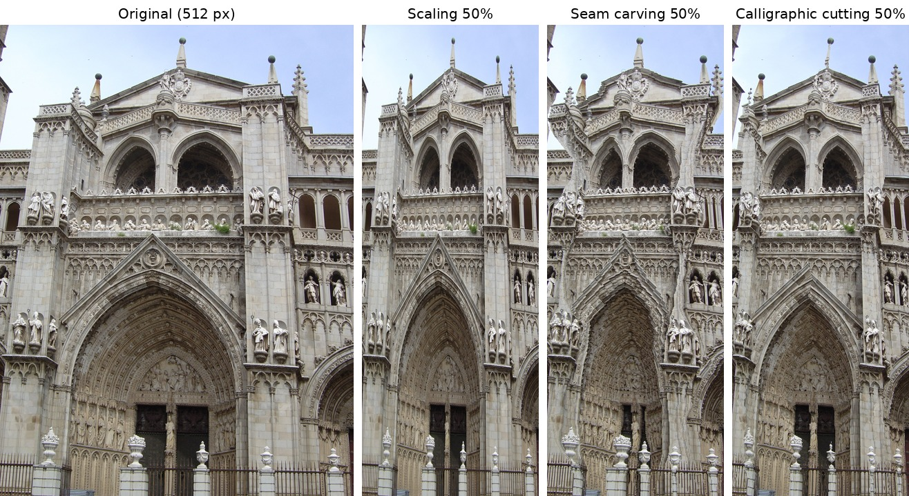

# CalligraphicCut

Python re-implementation of **Calligraphic Cutting: Discrete Image Resizing with Cuts in Continuous Domain**
(Youyou Wang, Ergun Akleman — CGI 2013). The original MatLab code was lost; this version was rebuilt
from the paper, its LaTeX sources, figures and the 2013 result images (2026-11).



*Paper teaser, reproduced with this code: 512 → 256 px wide. Scaling changes slopes and curvatures;
seam carving breaks the pillars and the pointed arch; calligraphic cutting keeps them intact and moves
the arch down. Run it yourself: `.venv/bin/cc-resize tests/data/paper/teaser_orig.jpg out.png --width 256`.*

## Idea in one paragraph
Seam carving removes 8-connected pixel paths, so once flat regions are used up it must cut across
edges (jaggies, broken lines). Calligraphic cuts are defined in the continuous domain: a width-λ strip
around a medial axis `x = f(y)` with *no* slope limit. The medial axis follows the image isocurves
(tangent ⟂ ∇F — "type-2" cuts keep slopes/G1), passes vertically through near-horizontal edges /
extrema ("type-3"), and may run horizontally through flat areas ("type-1"/horizontal chains). Pixels are
piecewise-constant squares, the axis is piecewise linear, so after removal each new pixel is an
area-weighted mix of exactly two old pixels.

## Usage
```bash
git clone https://github.com/frankwings/CalligraphicCut.git && cd CalligraphicCut
./install.sh                 # venv + deps + smoke test  (--service: systemd unit, --dev: run tests)
.venv/bin/cc-resize in.png out.png --width 300        # shrink width (CLI)
.venv/bin/cc-resize in.png out.png --height 400       # shrink height
.venv/bin/cc-server                                   # local lab UI: http://127.0.0.1:8097
python3 -m pytest -q
```
```python
from calligraphic_cut import Params, resize
out = resize(img_float_rgb_0to1, target_w=300, p=Params(xi1=0.003, xi2=0.3))
```

### Local lab server (`cc-server`, Gradio)
* **Resize & compare** — upload (or pick a paper example), width/height %, ξ1/ξ2, CC vs seam carving vs
  scaling side by side with timings; optional perturbation seed (1e-9 noise) to see run-to-run spread.
* **Progressive** — N frames from 100 % down to the target, next cut drawn in red.
* Lossless PNG output; inputs larger than 1600 px are downscaled. API usable via `gradio_client`
  (`/run_resize`, `/run_progressive`).
* Deployed as systemd user unit: `deploy/calligraphiccut.service`
  (`systemctl --user restart calligraphiccut`; logs `journalctl --user -u calligraphiccut`).
  Behind a path proxy set `CC_ROOT_PATH=/cc`.

## Layout
| path | content |
|---|---|
| `calligraphic_cut/core.py` | numpy reference: gradients, medial-axis construction (Sec 4.2), energy accumulation + horizontal chains (4.3), both directions, area-weighted removal (4.1) |
| `calligraphic_cut/fast.py` | numba kernels + incremental resize engine, **bit-identical** to the reference (tested), ~35× faster |
| `calligraphic_cut/seam_carving.py` | baseline: original seam carving (Avidan & Shamir 2007) |
| `calligraphic_cut/cli.py`, `server.py` | `cc-resize` CLI, `cc-server` Gradio lab |
| `deploy/` | systemd user unit |
| `scripts/` | `cc_resize` (wrapper), `teaser`, `fig2`, `sweep` (param search), `run_all` (RetargetMe batch), `make_montages`, `viz_cuts` |
| `docs/USAGE.md` | user guide with screenshots: web lab / CLI / API |
| `docs/ARCHITECTURE.md` | algorithm, implementation details, architecture, exactness contract, performance |
| `docs/DECISIONS.md` | every place the paper is silent/inconsistent and what we chose |

## Validation (vs. the 2013 MatLab outputs)
* Paper Fig. 2 (two-colour ellipses, 512→189): identical behaviour — ellipses intact, SC breaks them.
* Teaser (Toledo cathedral, 50% / 66%): pointed arch moves down intact, doors preserved, as in the paper.
* 36 RetargetMe cases (incl. one vertical): CC-python closer to the 2013 result than SC in 26–28/36
  (mean SSIM ≈0.38–0.40 vs 0.33; varies between equivalent builds, see ARCHITECTURE §3.6).
  SSIM vs a retargeted reference is alignment-sensitive → used for ranking only.
* Speed (numba engine, 1 core): face 392→294 0.16 s; teaser 512×683 → 50% 1.2 s; 1024×697 → 50% 5.6 s.

Defaults `xi1=0.003, xi2=0.3` (luminance Sobel/8, image in [0,1]); tuned on 7 images, confirmed on 10 hold-out.

## Tests
* `tests/test_core.py`, `tests/test_fast.py` — unit tests; numba == numpy bit-exact, cut by cut.
* `tests/test_e2e_paper.py` — **end-to-end, pinned to the paper** (~15 s):
  * A. paper claims on the paper's own figures vs the 2013 MatLab outputs (`tests/data/paper/`):
    Fig. 2 every shape pixel kept + mask IoU > 0.99 with 2013 (SC < 0.8); teaser 50 % structurally closer
    to 2013 than SC; face 75 % preserved (Fig. 12). Each claim is also asserted to fail for SC.
  * B. golden regression: exact uint8 outputs in `tests/data/golden/`. Intended change →
    `UPDATE_GOLDEN=1 python3 -m pytest tests/test_e2e_paper.py`, re-check A + visuals, commit goldens.
  * Mutation-checked: xi1=0.02 or tangent-following disabled (alpha=0) both make the suite fail.

## Not (yet) covered
Enlarging (paper does not define it); improved seam carving (forward energy) baseline; saliency maps.

## License
Code: MIT © 2026 Zengyn42 (see `LICENSE`).
Test/demo images under `tests/data/` and `docs/img/` are third-party (RetargetMe benchmark images,
a photograph of Toledo Cathedral, and figures/results of the 2013 paper) and are included for research
reproduction only; they are not covered by the MIT license.
