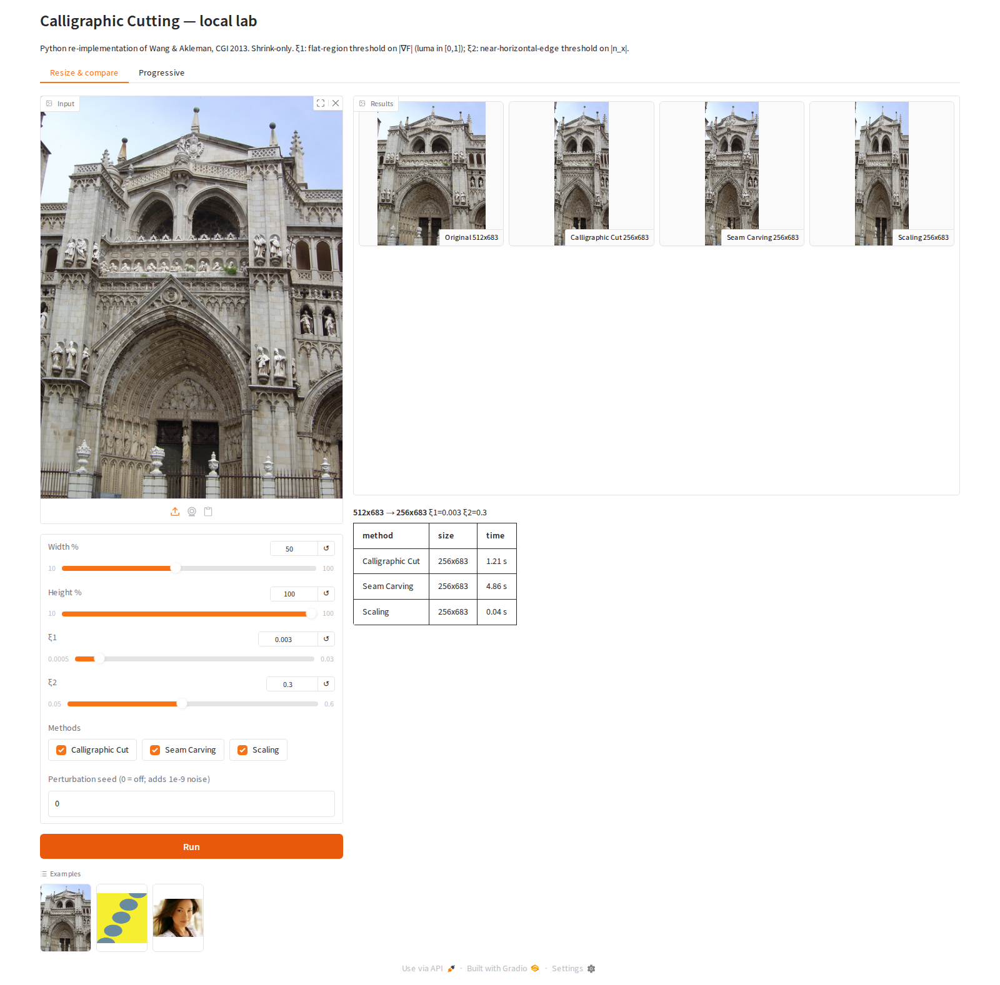

# CalligraphicCut 使用说明

本工具是 Calligraphic Cutting（Wang & Akleman, CGI 2013）的 Python 重新实现，提供三种用法：
**本地网页实验室**（推荐）、**命令行**、**Python API**。只支持缩小（论文没有定义放大）。

---

## 1. 启动本地网页实验室

服务已作为 systemd 用户服务部署，开机自启：

| 操作 | 命令 |
|---|---|
| 打开 | 浏览器访问 **http://127.0.0.1:8097** |
| 重启 | `systemctl --user restart calligraphiccut` |
| 停止 | `systemctl --user stop calligraphiccut` |
| 日志 | `journalctl --user -u calligraphiccut -f` |

> 在 Hani 等非交互环境中执行 `systemctl --user` 前需要
> `export XDG_RUNTIME_DIR=/run/user/$(id -u)`。

手动启动（不用 systemd）：
```bash
cd ~/Projects/CalligraphicCut
.venv/bin/cc-server                    # 默认 127.0.0.1:8097
.venv/bin/cc-server --port 9000        # 换端口
```
首次启动会编译 numba 内核（约 10–20 秒），之后有缓存。


---

## 2. 「Resize & compare」——一次缩放，多种方法对比



**操作步骤**
1. 左上 **Input** 上传图片，或点左下 **Examples** 里的论文示例（Toledo 大教堂 / 双色椭圆 / 人脸）。
2. 设定 **Width %** / **Height %**（例：宽 50%、高 100% = 只缩宽度一半）。
3. 需要时调整 **ξ1 / ξ2**（见第 4 节）。
4. 在 **Methods** 勾选要对比的方法：Calligraphic Cut / Seam Carving / Scaling。
5. 点 **Run**。

**结果怎么看**
* 右侧 **Results** 依次为原图和各方法结果，图下标注尺寸；点击可放大，可下载（无损 PNG）。
* 下方表格给出每种方法的输出尺寸与耗时。上图示例：teaser 512→256，CC 1.2 s，SC 4.9 s。
* 观察重点：直线、拱门、立柱是否断裂或弯曲（SC 的典型问题）；CC 应保持边缘的直线和斜率。

**Perturbation seed（扰动种子）**
* `0` = 关闭。填入非 0 整数，会给输入加一份 1e-9 量级的随机噪声（同一种子可复现，肉眼不可见）。
* 用途：观察结果的**运行间差异**。贪心逐刀选切线，近似并列的切线会被极小差异左右；
  换几个种子，就能看到同一组参数下结果的稳定程度。

---

## 3. 「Progressive」——逐步缩小并显示下一刀


**操作步骤**
1. 上传图片或点示例。
2. **Final width %**：最终宽度；**Frames**：中间帧数。
3. 勾选 **Overlay next cut (red)**，每帧会用红线画出下一条将被删除的切线。
4. 点 **Run**。

**结果怎么看**
* 每帧下标注当前宽度及百分比。红线显示切线的实际走向：在平坦区横向移动、沿边缘走、
  在接近水平的边上竖直穿过——即论文的 type-1 / 2 / 3 切线。
* 上图人脸示例中，宽度降到约 60% 以下后，背景和头发可删的部分用尽，切线开始穿过脸部，
  这就是该图的极限。

---

## 4. 参数说明与实验建议

| 参数 | 含义 | 默认 | 调大 / 调小的效果 |
|---|---|---|---|
| **ξ1** | 梯度大小阈值：\|∇F\| ≤ ξ1 视为平坦区，切线可沿水平链自由横移 | 0.003 | 调大 → 更多区域算"平"，切线更易横穿大块平滑区域（如皮肤）；0.02 会切坏人脸 |
| **ξ2** | 梯度方向阈值：\|n_x\| ≤ ξ2 视为接近水平的边 / 极值点，切线只能竖直穿过 | 0.3 | 调大 → 更多地方只能竖直穿过；调小 → 更多地方顺着边走 |
| Perturbation seed | 测试工具，不属于算法 | 0 | 见第 2 节 |

ξ1 以亮度 ∈ [0,1]、Sobel/8 梯度为单位。默认值在 7 张 RetargetMe 图上调出，并在另外 10 张图上验证。

**推荐实验流程**
1. 先用默认参数跑，和 Seam Carving 对比。
2. 调 ξ1 / ξ2，看结果整体往哪个方向变化。
3. 固定参数，换 3–5 个扰动种子，判断这组参数在这张图上是否稳定。
4. 用 Progressive 找到这张图的极限宽度（切线开始穿过主体的位置）。

---

## 5. 命令行

```bash
cd ~/Projects/CalligraphicCut
.venv/bin/cc-resize in.png out.png --width 300            # 缩宽到 300 px
.venv/bin/cc-resize in.png out.png --height 400           # 缩高到 400 px
.venv/bin/cc-resize in.png out.png --width 300 --xi1 0.005 --xi2 0.25
```

## 6. Python API

```python
from calligraphic_cut import Params, resize
from calligraphic_cut.io import load, save

img = load("in.png")                                  # float RGB, [0,1]
out = resize(img, target_w=300, p=Params(xi1=0.003, xi2=0.3))
save("out.png", out)
```

## 7. 通过 API 调用正在运行的服务

```python
from gradio_client import Client, handle_file
c = Client("http://127.0.0.1:8097/")
gallery, info = c.predict(handle_file("in.png"), 50, 100, 0.003, 0.3,
                          ["Calligraphic Cut", "Seam Carving"], 0, api_name="/run_resize")
frames, info = c.predict(handle_file("in.png"), 50, 8, 0.003, 0.3, True, api_name="/run_progressive")
```
服务输出与直接调用库的结果逐像素一致（已验证）。

---

## 8. 常见问题

* **只能缩小**：目标尺寸 ≥ 原图时会提示，论文未定义放大。
* **大图**：输入超过 1600 px 会先等比缩小再处理，并在结果说明中标注。
* **速度**：CC 在 512×683 缩一半约 1.2 s，1024 宽缩一半约 5.6 s；Seam Carving 基线较慢。
* **同一张图结果略有不同**：属于算法固有的敏感性，见 `ARCHITECTURE.md` §3.6 与 `DECISIONS.md` D7。
* **重新截图**：`python3 scripts/screenshots.py`（需要服务在运行，以及 playwright + chromium）。

更多原理与实现细节见 [ARCHITECTURE.md](ARCHITECTURE.md)；论文未写清处的取舍见 [DECISIONS.md](DECISIONS.md)。
