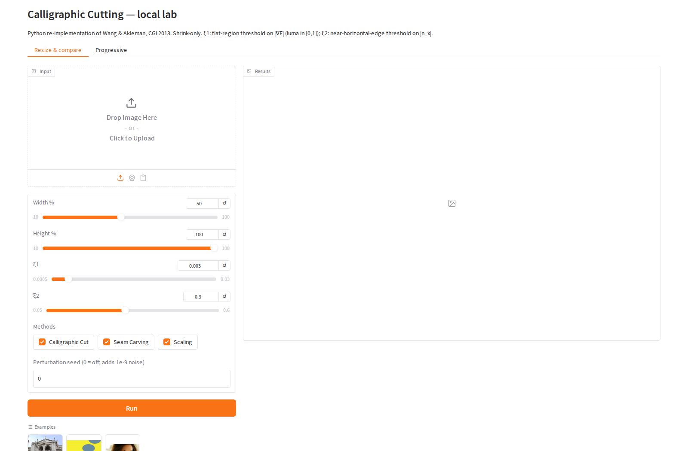
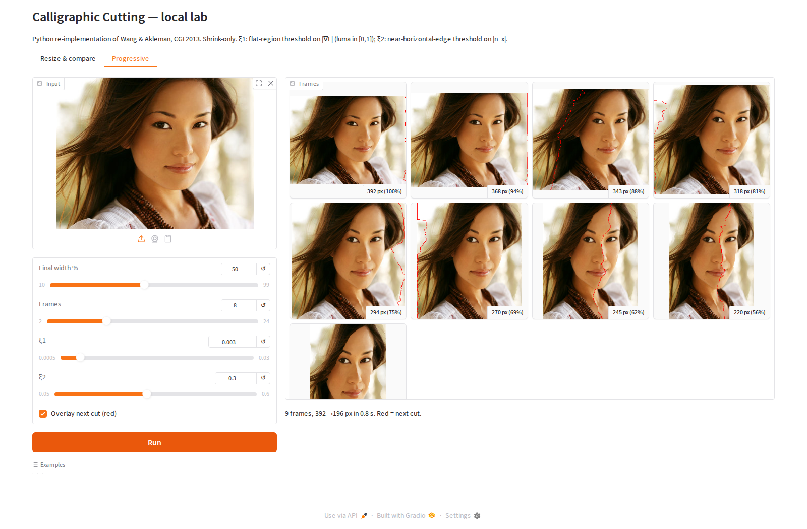

# CalligraphicCut — User Guide


Python re-implementation of Calligraphic Cutting (Wang & Akleman, CGI 2013). Three ways to use it:
the **local web lab** (recommended), the **command line**, and the **Python API**.
Shrinking only — the paper does not define enlarging.

---

## 0. Quick start (any OS)

```bash
git clone https://github.com/frankwings/CalligraphicCut.git && cd CalligraphicCut
python3 launch.py          # Windows: py launch.py
```
`launch.py` needs only Python ≥ 3.10. The first run creates `.venv` and installs the dependencies
(a few minutes); every run then starts the lab and opens it in your browser. Stop it with Ctrl+C or
by closing the window. Options: `--port 9000`, `--no-browser`.

## 0b. Install with install.sh (Linux; optional systemd service)

```bash
./install.sh              # creates .venv, installs numpy/scipy/numba/pillow/gradio, runs a self-test
./install.sh --dev        # also installs test dependencies and runs the full test suite
./install.sh --service    # Linux only: also installs and starts a systemd user service on 127.0.0.1:8097
```
Options: `--system-site` reuses already-installed system packages; `PYTHON=python3.12` picks the
interpreter; `CC_PORT=9000` changes the port. Needs Python ≥ 3.10 (Debian/Ubuntu: `python3-venv`).
Tested on Linux (Ubuntu under WSL2). macOS should work with a Python ≥ 3.10 from Homebrew, e.g.
`PYTHON=python3.12 ./install.sh` (the system `python3` on macOS is usually 3.9).

## 1. Start the local web lab

```bash
.venv/bin/cc-server                  # http://127.0.0.1:8097
.venv/bin/cc-server --port 9000      # another port
```
The first start compiles the numba kernels (about 10–20 s); later starts use the cache.

If you installed with `--service`: `systemctl --user restart|stop calligraphiccut`,
logs with `journalctl --user -u calligraphiccut -f`.



---

## 2. Tab "Resize & compare" — one resize, several methods


**Steps**
1. Upload an image (**Input**), or click one of the paper examples under **Examples**
   (Toledo cathedral / two-colour ellipses / face).
2. Set **Width %** and **Height %** (e.g. width 50, height 100 = halve the width only).
3. Optionally change **ξ1 / ξ2** (section 4).
4. Tick the methods to compare: Calligraphic Cut / Seam Carving / Scaling.
5. Click **Run**.

**Reading the result**
* **Results** shows the original and each method with its size; click to enlarge, download as lossless PNG.
* The table below lists output size and run time per method.
* "Seam Carving" here is the original method (Avidan & Shamir 2007, backward energy), not the
  improved seam carving used in the paper's comparisons.
* What to look at: straight lines, arches and pillars — broken or bent with seam carving, kept
  straight with calligraphic cuts.

**Perturbation seed**
* `0` = off. A non-zero integer adds random noise of about 1e-9 to the input (invisible,
  reproducible per seed).
* Purpose: see the run-to-run spread. Greedy cut selection is decided by tiny differences when
  several cuts have nearly the same energy; a few seeds show how stable a parameter setting is.

---

## 3. Tab "Progressive" — shrink step by step, show the next cut



**Steps**
1. Upload an image or click an example.
2. **Final width %** and number of **Frames**.
3. Tick **Overlay next cut (red)** to draw the next cut on every frame.
4. Click **Run**.

**Reading the result**
* Each frame shows its current width. The red line is the actual cut: it moves sideways through flat
  areas, follows edges, and crosses near-horizontal edges vertically (the paper's type-1/2/3 cuts).
* In the face example, below about 60 % width the background and hair are used up and the cut
  starts to cross the face — the limit for this image.

---

## 4. Parameters

| Parameter | Meaning | Default | Effect |
|---|---|---|---|
| **ξ1** | gradient-magnitude threshold: \|∇F\| ≤ ξ1 counts as flat, the cut may move freely along horizontal chains | 0.003 | larger → more area counts as flat, cuts cross smooth regions (e.g. skin) more easily; 0.02 damages the face |
| **ξ2** | gradient-direction threshold: \|n_x\| ≤ ξ2 counts as a near-horizontal edge / extremum, the cut goes straight up | 0.3 | larger → more places are crossed vertically; smaller → cuts follow edges more |
| Perturbation seed | testing aid, not part of the algorithm | 0 | see section 2 |

ξ1 is in units of luminance ∈ [0,1] with Sobel/8 gradients. Defaults were tuned on 7 RetargetMe
images and checked on 10 others (see DECISIONS.md).

**Suggested workflow**: run with defaults and compare with seam carving → vary ξ1/ξ2 → fix the
parameters and try 3–5 perturbation seeds → use Progressive to find the image's limit.

---

## 5. Command line

```bash
.venv/bin/cc-resize in.png out.png --width 300
.venv/bin/cc-resize in.png out.png --height 400
.venv/bin/cc-resize in.png out.png --width 300 --xi1 0.005 --xi2 0.25
```

## 6. Python API

```python
from calligraphic_cut import Params, resize
from calligraphic_cut.io import load, save

img = load("in.png")                                  # float RGB in [0,1]
out = resize(img, target_w=300, p=Params(xi1=0.003, xi2=0.3))
save("out.png", out)
```

## 7. Calling the running server

```python
from gradio_client import Client, handle_file
c = Client("http://127.0.0.1:8097/")
gallery, info = c.predict(handle_file("in.png"), 50, 100, 0.003, 0.3,
                          ["Calligraphic Cut", "Seam Carving"], 0, api_name="/run_resize")
frames, info = c.predict(handle_file("in.png"), 50, 8, 0.003, 0.3, True, api_name="/run_progressive")
```
The server output is pixel-identical to calling the library directly.

---

## 8. FAQ

* **Shrinking only** — a target ≥ the input size is rejected.
* **Large inputs** — images over 1600 px are downscaled first; the result note says so.
* **Speed** — teaser 512×683 → 50 % takes about 1–3 s on one CPU core after the one-time compile.
* **Results differ slightly between runs with noise** — inherent to greedy cut selection; see
  ARCHITECTURE.md §3.6 and DECISIONS.md D7.
* **Regenerate screenshots** — `python3 scripts/screenshots.py` (server running; needs playwright + chromium).

Algorithm and implementation: [ARCHITECTURE.md](ARCHITECTURE.md). Choices where the paper is
silent: [DECISIONS.md](DECISIONS.md).
